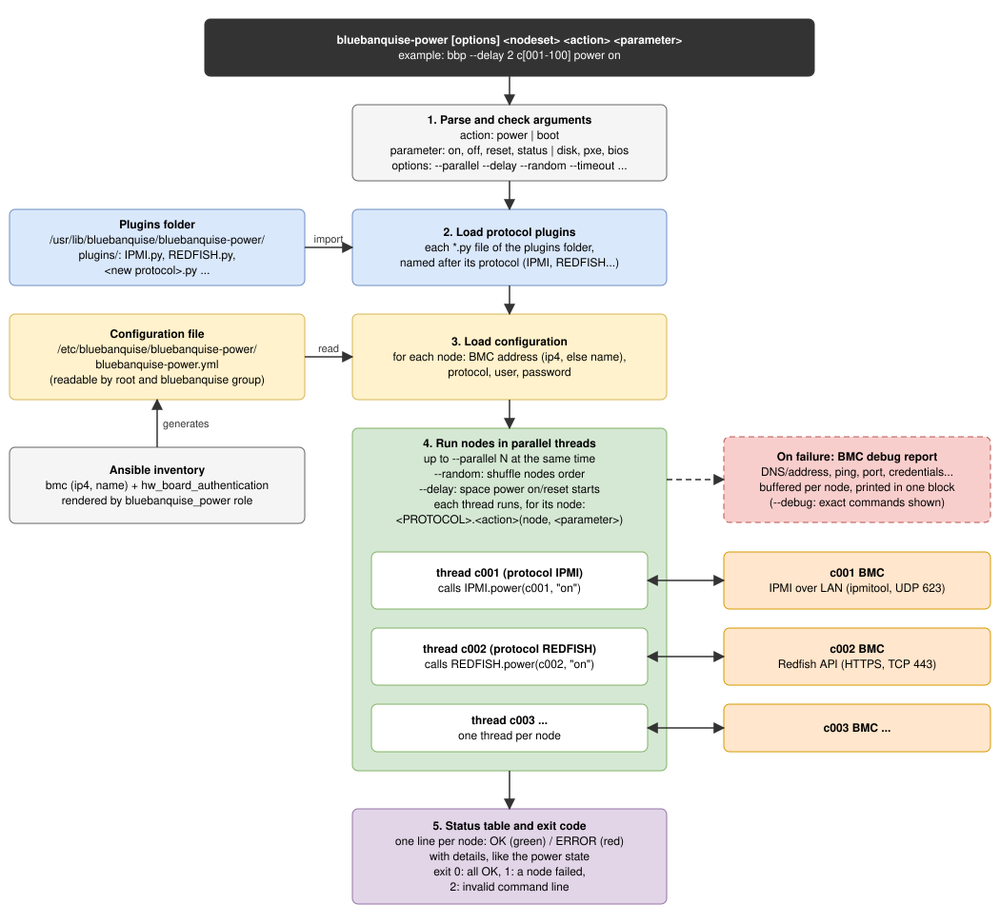

# BlueBanquise power

## Description

This role installs **bluebanquise-power** (and its short alias **bbp**), a command line tool to
manage hosts power and next boot device through their BMC, using IPMI or Redfish.

The tool reads a configuration file generated from the inventory, so hosts are targeted by their
hostname (or a nodeset), never by their BMC address or credentials.

## How it works



1. The command line is checked: an action (`power` or `boot`), its parameter, and options.
2. Protocol plugins are loaded from `/usr/lib/bluebanquise/bluebanquise-power/plugins/`: each
   Python file is one protocol, named after it (`IPMI.py`, `REDFISH.py`).
3. The configuration file generated by the role from the inventory,
   `/etc/bluebanquise/bluebanquise-power/bluebanquise-power.yml`, is loaded: for each host, its BMC
   address, protocol and credentials.
4. Hosts are processed in parallel threads (`--parallel`, `--delay`, `--random` options). For its
   host, each thread calls the function named after the action, in the plugin of the host protocol,
   with the parameter: for example `IPMI.power(c001, "on")` or `REDFISH.boot(c002, "pxe")`. The
   plugin then talks to the host BMC (ipmitool for IPMI, HTTPS for Redfish). If the action fails, a
   BMC debug report is printed.
5. Once all hosts are done, a status table summarizes results, and the exit code tells if all
   succeeded.

The schema is a `.drawio.svg` file: it displays as a normal image, and can be opened and edited
with [draw.io](https://www.drawio.com/) (diagrams.net).

## Instructions

### Inventory

For a host to be managed by bluebanquise-power, it needs:

* A `bmc` entry in its host variables, with an `ip4` and/or a `name`. The tool connects to the BMC
  using `ip4` when it is set, else using `name`, which must then be resolvable from the management
  host (typically through the `hosts_file` or `dns_server` roles). Setting `ip4` is recommended:
  besides not depending on name resolution, some BMCs refuse HTTPS (Redfish) requests using a name
  that is not their own configured name. For example Dell iDRAC9, since firmware 5.10, answers
  `400 Bad Request` (HostHeaderCheck feature), while its IP address is always accepted:

```yaml
c001:
  bmc:
    name: c001-bmc
    ip4: 10.10.103.1
    mac: 08:00:27:0d:44:91
    network: net-admin
```

* A `hw_board_authentication` list in its hardware group (`hw_*`), defining the protocol and
  credentials to use. The first entry defining a `protocol` is used:

```yaml
hw_board_authentication:
  - protocol: IPMI
    user: ADMIN
    password: ADMIN
```

`protocol` must be exactly `IPMI` or `REDFISH` (upper case), as it is the name of the plugin used.

With Redfish, the system to manage is discovered automatically from the BMC `Systems` collection,
whatever the vendor. If the BMC exposes several systems (for example a blade chassis), the first one
is used. To manage another one, set `system_id` to its Id (the last part of its Redfish path, like
`System.Embedded.1` or `Self`). As the Id depends on the hardware model, it is set with the
credentials:

```yaml
hw_board_authentication:
  - protocol: REDFISH
    user: admin
    password: password
    system_id: System.Embedded.1
```

Always quote `user` and `password` values in the inventory if they could be interpreted by YAML:
an unquoted `password: 0123` is read by Ansible as the number `83` (octal), and `password: yes` as
the boolean `true`, before this role can do anything about it. Use `password: "0123"`. Any quoted
value, special characters included, is then passed to the BMC as is.

Hosts without a `bmc` entry, or without a complete `protocol`/`user`/`password` set in the first
`hw_board_authentication` entry defining a `protocol`, are silently skipped when generating the
configuration.

By default all hosts of the inventory are considered. To restrict the configuration to a group of
hosts, set `bluebanquise_power_restrict_to_group` (or the global `bb_restrict_to_group`) to an
Ansible group name.

### Deploy

Apply the role on the management host(s). The `bluebanquise` group must exist on these hosts
(it is created with the `bluebanquise` user during BlueBanquise bootstrap). The role installs the `ipmitool` and `bluebanquise-venv`
packages (the tool runs from the BlueBanquise Python virtual environment, located in
`/usr/lib/bluebanquise/venv/`), and generates:

* `/etc/bluebanquise/bluebanquise-power/bluebanquise-power.yml`: the hosts configuration, including
  BMC credentials. This file is owned by root and only readable by the `bluebanquise` group, so
  only root and members of this group (like the `bluebanquise` user) can use the tool. No root
  privileges are needed: IPMI over LAN and Redfish only use the network.
* `/usr/bin/bluebanquise-power` and `/usr/bin/bbp`: the tool, a Python script running with the
  virtual environment interpreter.
* `/usr/lib/bluebanquise/bluebanquise-power/plugins/`: the protocol plugins.

Re-run the role each time BMC related inventory data changes, to regenerate the configuration.

### Usage

```
bluebanquise-power [--dryrun] [--debug] [--timeout SECONDS] [--parallel N] [--delay SECONDS] [--random]
                   <nodeset> <action> <parameter>
```

`<nodeset>` follows ClusterShell nodeset format (`c001`, `c[001-010]`, `c001,login1`, ...).

Available actions:

| Action  | Parameter | Effect |
|---------|-----------|--------|
| `power` | `on`      | Power on host. With Redfish, does nothing if host is already on. |
| `power` | `off`     | Hard power off host (not a graceful shutdown). With Redfish, does nothing if host is already off. |
| `power` | `reset`   | Hard reset host. |
| `power` | `status`  | Display host power state. |
| `boot`  | `pxe`     | Set next boot device to PXE (one time). |
| `boot`  | `disk`    | Set next boot device to disk (one time). |
| `boot`  | `bios`    | Set next boot device to BIOS setup (one time). |

Examples:

```
bbp c001 power status
bbp c[001-004] boot pxe
bbp c[001-004] power reset
bbp --delay 2 --random c[001-100] power on
```

Options:

* `--dryrun`: display what would be done, without contacting BMCs. Passwords are masked.
* `--debug`: display debug messages, including each executed IPMI command, or for Redfish each
  request as an equivalent `curl` command followed by the BMC response, in plain text, **BMC
  password included**, ready to be copy-pasted to reproduce an issue manually. Be careful: pasting
  this command into a shell stores the password in the shell history (with bash, prefixing the
  command with a space avoids it if `HISTCONTROL` contains `ignorespace` or `ignoreboth`).
* `--timeout`: timeout in seconds of each IPMI command or Redfish request (default `10`). A BMC
  that does not answer makes the action fail after this delay, instead of blocking the tool.
* `--parallel`: maximum number of hosts handled at the same time (default `16`).
* `--delay`: for `power on` and `power reset` only, minimum delay in seconds (decimals allowed,
  like `0.5`) between two hosts starting, whatever the `--parallel` value (default `0`, no delay).
  Powering on many hosts at the exact same time can trip PDUs or breakers because of the inrush
  current: `--delay 2` makes sure at most one host starts powering on every 2 seconds.
* `--random`: process hosts in random order. Hosts are usually numbered by rack, so consecutive
  hosts often share the same PDU: combined with `--delay`, this spreads power on across racks.

BMC passwords are never passed on a command line: ipmitool receives the password through its
`IPMI_PASSWORD` environment variable (`ipmitool -E`), so it cannot be seen by other users with
`ps`. Note that IPMI v2.0 limits passwords to 20 bytes.

Hosts are processed in parallel. Each log line is prefixed with its host name (`[c001]`), and a
BMC debug report (see Troubleshooting) is printed in one block, never mixed with other hosts output.
An error on a host does not stop the others. At the end, a status table shows the result of each
host (`OK` in green, `ERROR` in red, colors only when writing to a terminal) with a detail, like the
power state for `power status`:

```
NODE  RESULT  DETAILS
c001  ERROR   could not get node power status
c002  OK      On
c003  OK      Off
```

Failed hosts are then listed (as a nodeset), and the tool exits with code
`1` if the action failed on at least one host (a requested host missing from the configuration
counts as a failure), `2` if the command line is invalid (unknown action or parameter, malformed
nodeset), `0` otherwise, so it can be used in scripts:

```
bbp c[001-004] power on || echo "Some hosts did not power on"
```

### Troubleshooting

When an action fails, the tool automatically prints a **BMC debug report** for the host, to help
understand where things break:

* **IPMI**: BMC address (`ip4`, or `name` DNS resolution), ICMP ping, a UDP/623 RMCP presence ping, then a verbose
  read-only `ipmitool chassis status` handshake, whose output is matched against common failure
  causes (BMC unreachable, session/cipher suite issue, user rejected, wrong password, no free
  session).
* **Redfish**: BMC address (`ip4`, or `name` DNS resolution), ICMP ping, Redfish service root
  reachability over HTTPS (no authentication, with a hint if the BMC refuses the name used, see
  Dell iDRAC note above), credentials check, then BMC firmware/model/health and system power/boot
  state if credentials are valid.

Note that ICMP is often filtered while IPMI or HTTPS still work, so a ping failure alone is not
conclusive.

### Protocols details

**IPMI** relies on `ipmitool -I lanplus` (IPMI v2.0 over LAN).

**Redfish** is vendor agnostic: the system resource is discovered from the BMC `Systems` collection
instead of assuming a vendor specific identifier. Some BMCs require an `If-Match` header on boot device
changes: the resource etag is fetched and sent automatically. If a BMC exposes several systems,
the first one is used, unless `system_id` is set in `hw_board_authentication` (see Inventory above).
BMC TLS certificates are not verified, as BMCs usually use self signed certificates.

### Adding a protocol

Each protocol is a Python file in `files/plugins/`, named after the `protocol` value
(`IPMI.py`, `REDFISH.py`), exposing one function per action (`power`, `boot`), with the signature
`action(node, node_configuration, parameter, parameters, logger)` (`parameter` is the action
parameter, like `on` or `pxe`, and `parameters` the command line options), returning a
`(return_code, detail)` tuple: `return_code` is `0` on success and `1` on failure, `detail` is the
short text displayed in the final status table. As hosts run in parallel, a plugin must not print
multi-line output line by line: build it as a list, then log it with a single call (see
`debug_bmc()` and `fail()` in existing plugins). All files of `files/plugins/` are deployed by the
role. At startup, the tool loads every plugin: a plugin that cannot be loaded (for example because
of a missing Python module) is reported as a warning, and only hosts using this protocol fail.

## Variables

| Variable | Default | Description |
|----------|---------|-------------|
| `bluebanquise_power_restrict_to_group` | `bb_restrict_to_group`, else `all` | Only consider hosts of this Ansible group when generating the configuration. |
