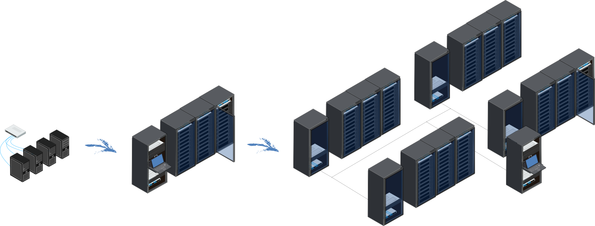

====================
What is BlueBanquise
====================

Welcome! I am really happy you are here.

**BlueBanquise** is a free and open source stack, based on Ansible, to deploy and manage clusters of
hosts. These clusters can be anything from a few workstations in a classroom, to a render farm, a
university infrastructure, or very large HPC clusters and server farms.

BlueBanquise was born from the need for a stack that stays simple, while being able to manage very
complex architectures. It also aims to help new system administrators learn how bare metal servers
are deployed and managed: everything it does is plain configuration files and Ansible code, that you
can read, understand, and change.

What it does
============

From a single management host, BlueBanquise takes care of the whole life of a cluster:

* **Describe** the cluster in one place, an Ansible inventory: networks, hosts, hardware, operating
  systems, services. Plain text files, easy to read, and to keep in git.
* **Deploy** operating systems on bare hosts over the network (PXE), unattended: RHEL and
  compatible distributions, Ubuntu, Debian, OpenSuse Leap. Hosts can also boot diskless images.
* **Configure** hosts and core services: network interfaces, repositories, firewall, DHCP, DNS,
  time, hosts files, SSH, users, system settings, storage.
* **Specialise** the cluster for what it is made for: Slurm job scheduler, InfiniBand interconnect,
  GPUs, NFS and Lustre storage, containers (Podman, Singularity), environment modules.
* **Operate** it: power management and consoles through BMCs, centralized logs, monitoring and
  alerting with Prometheus and Grafana, hardware errors tracking, updates.
* **Scale** it: split very large clusters into icebergs, or share services between several
  management hosts, with high availability.

``[SCHEMA: bluebanquise-stack-overview]``
  *A layered picture: at the bottom, the inventory (networks, hosts, groups, hw/os settings); above
  it, Ansible and the bluebanquise.infrastructure collection on the management host; above, four
  columns of roles (Deploy: dhcp_server, pxe_stack, http_server; Configure: nic, repositories,
  firewall, local_configuration, time, dns...; Specialise: slurm, nfs, gpu, interconnect...;
  Operate: bluebanquise_power, conman, rsyslog, prometheus...); at the top, the cluster hosts
  (login, storage, computes).*

How it works
============

BlueBanquise is an Ansible *collection*, ``bluebanquise.infrastructure``, made of roles. Each role
configures one thing (a service, a system setting, a tool), reading its settings from the inventory.
A few principles make the whole stack consistent:

* **One inventory, one data model.** All roles share the same description of the cluster (see
  :doc:`vocabulary`, and the data model reference of the repository, ``resources/data_model.md``).
  A host declared once is known to DHCP, DNS, PXE, hosts files, monitoring...
* **Groups.** Each host belongs to a function group (what it does), a hardware group (what it is),
  and an operating system group (what it runs). Settings are given to groups, so a thousand
  identical hosts are described as easily as one.
* **Sensible defaults.** Roles work out of the box with few settings, and let you tune everything
  when needed.
* **Multi distributions.** The same inventory and roles work on RHEL 9 and 10 (and compatible
  distributions), Ubuntu 24.04 and 26.04, Debian 13, and OpenSuse Leap 16.

Why Ansible
===========

The project relies on **Ansible**, chosen for its simplicity and its security: it only needs SSH and
Python on hosts, no agent. Its inventory groups and variables mechanism covers everything from very
simple to very sophisticated configurations. Ansible is not the fastest tool, nor always the
simplest to debug, but it is easy to learn, widely used, and backed by a large and active community.

How to read this documentation
==============================

* New to BlueBanquise? Read :doc:`installation` and :doc:`vocabulary`, then follow the
  **Walkthrough**: it builds a complete cluster step by step.
* The **General configuration** section describes the inventory, and each role of the stack, in
  detail.
* **Specialisation** covers HPC clusters, **Deployment** the order and tools to deploy, and
  **Operations** the day to day life of the cluster.
* **Scalability and high availability** is for when the cluster grows.

As BlueBanquise supports several Linux distributions, some parts of this documentation are specific
to one of them: this is always explicitly mentioned.

Getting help
============

If you find a bug, have a question, or simply want to share how you use the stack, you are very
welcome on `the discussions tab <https://github.com/bluebanquise/bluebanquise/discussions>`_ and
`the issues <https://github.com/bluebanquise/bluebanquise/issues>`_ of the project's GitHub.

I hope you will enjoy this stack as much as I enjoy developing it.
